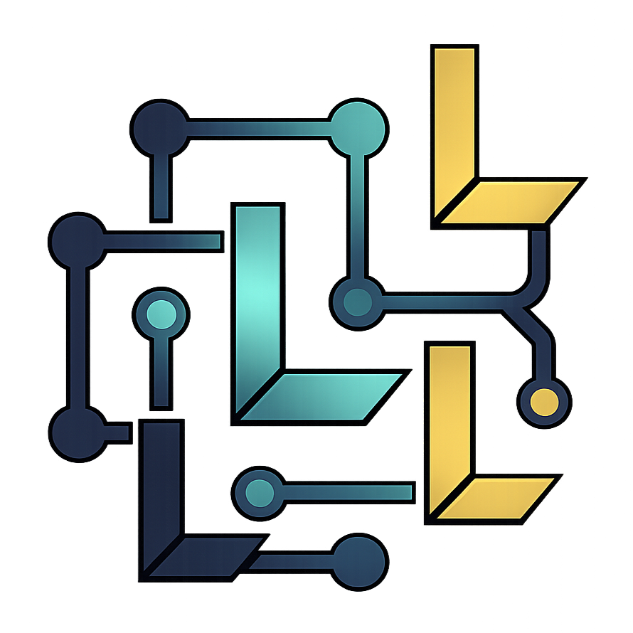
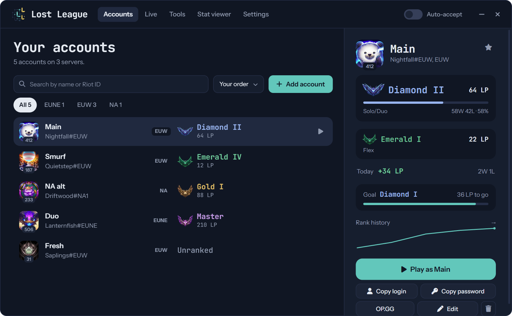
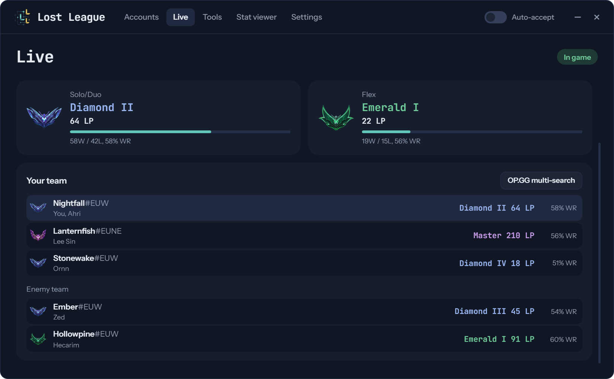
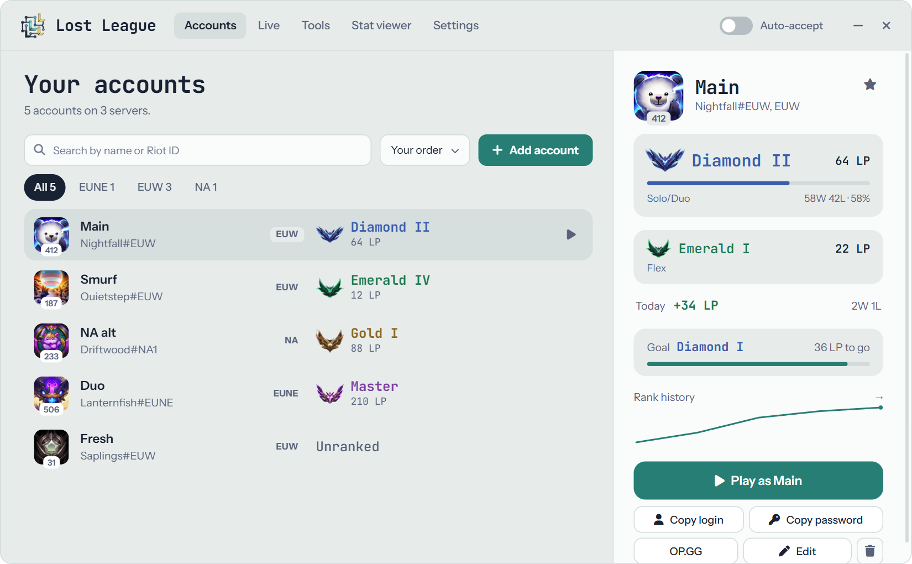

<div align="center">
  
  <h1>Lost League Manager</h1>
  <p>Save your League of Legends logins once, then switch accounts in one click.</p>

  <a href="https://www.lostleague.com/">
    
  </a>
  <a href="https://github.com/MouseWerk/lost-league-manager/releases/latest">
    
  </a>
  <a href="https://github.com/MouseWerk/lost-league-manager/releases">
    
  </a>
  <a href="https://github.com/MouseWerk/lost-league-manager/actions/workflows/release.yml">
    
  </a>
  
  <a href="https://discord.gg/ZyfUMWTPFe">
    
  </a>
  <br><br>
  <a href="https://www.buymeacoffee.com/mousewerk">
    
  </a>

  <br><br>
  
</div>

---

## What it does

### Accounts
- **One-click login.** Pick an account and press Play: the app closes the client, starts the Riot
  Client and signs in for you.
- **Quick add.** Type a Riot ID or paste an OP.GG link; rank, icon, server and label fill in. Or take
  the account that is signed into the client.
- **Ranks at a glance.** Every account shows its solo rank with the ranked emblem from the League
  client, LP and win rate. Ranks work without a Riot API key (League client, OP.GG, or the Riot API
  if you add a key).
- **Account panel.** Rank history, recent games, notes, today's LP and games, and a goal rank with
  the LP still to go. Open any game to see both teams, items, CS and damage, and a champion table
  with win rate, KDA and CS per minute.
- **Warnings.** Ranked decay ("Decays in 3 days"), a ranked restriction with the games left,
  accounts you have not played for a while, and the time left on a suspension ("Banned 1d 6h"),
  read from the Riot Client at sign-in or entered by hand.
- **Overview.** The week of all your accounts in one place: ranked games, win rate, LP and Blue
  Essence, a card per account with its rank, 30-day line and goal, a 30-day rank chart, and a list
  of everything that needs attention.
- **Season review.** Peak rank, the season's rank curve, most played champions and the longest win
  streak for each account; your record against each lane opponent.
- **Stays up to date.** Offers to add the account signed into the client, follows Riot ID changes,
  and shows each account's Blue Essence and RP from its last sign-in.
- **Find and sort.** Search by name, Riot ID or tag, filter by server or tag (Main, Duo, Smurf, ...),
  sort by rank, name, server, recently used or last played, or drag accounts into your own order.
  Select several accounts to tag, refresh, export or delete them together.
- **Safe storage.** Passwords are encrypted on your PC. An optional vault password locks the app,
  and backups are protected with a password you choose.

### While you play
- **Live view.** Your rank, champion mastery and recent games from the running client.
- **Lobby check.** The ranks of your party, of your champion select where the game shows names,
  and of all ten players once the game starts, with one click to OP.GG multi-search. Ranked
  champion select keeps names hidden, as the game does.
- **Today's session.** Games, record, LP and streak since midnight, with a break hint after two
  losses in a row.
- **Runes and items.** The OP.GG runes, items and skill order for your champion in champion
  select, imported into the client with one click or automatically when you lock in, plus the
  matchup against an enemy pick and how well you go with your duo.
- **In-game overlay (beta).** On the loading screen and while you hold Tab: both teams with rank,
  win rate and tags such as One-trick or New on champ. In the game: your score, team gold and
  objectives, timers for taken objectives, your build, and the item choices for every slot with
  their win and pick rate. Off until you switch it on.
- **Auto-accept**, a random owned skin in champion select, appear offline, dodge, a notification
  when a match is found, and a Discord status with your rank and champion (never your name).

### Stat viewer and tools
- **Champion stats** at any level from Riot's data, including the exact attack speed growth.
- **Item gold value.** What an item's stats are worth in gold, ability haste and penetration
  included.
- **Tools.** Close every Riot process, repair a client that will not start, clear the Riot Client
  cache, change the client language.

### The app
- Light and dark themes, or follow Windows. Interface size from 75% to 150%, and a Roomy layout
  with larger buttons and rows.
- A short setup on first start, automatic updates, tray menu and Windows jump list.

<div align="center">
  
  
</div>

---

## Install

1. Download `Lost-League-Manager-Setup.exe` from the
   **[latest release](https://github.com/MouseWerk/lost-league-manager/releases/latest)**.
2. Run the installer and start **Lost League Manager**.
3. The setup checks your League install and adds your first account.

> **Windows SmartScreen warning?** Right-click the installer, choose Properties, tick **Unblock**,
> click Apply and run it again. The app is not code-signed; the source is all here.

> **During the login** the app types your login name and password into the Riot Client. Leave
> mouse and keyboard alone for those few seconds.

---

## Community and help

Questions, bug reports or ideas: join the **[official Discord server](https://discord.gg/ZyfUMWTPFe)**
or open an issue here on GitHub. The website is **[lostleague.com](https://www.lostleague.com/)**.

---

## Build from source

```bash
git clone https://github.com/MouseWerk/lost-league-manager.git
cd lost-league-manager
npm install
npm start        # run the app
npm test         # unit and guard tests
npm run build    # build the installer
```

---

Lost League Manager is not endorsed by Riot Games and does not reflect the views or opinions of Riot
Games or anyone officially involved in producing or managing Riot Games properties. Riot Games and
all associated properties are trademarks or registered trademarks of Riot Games, Inc.
